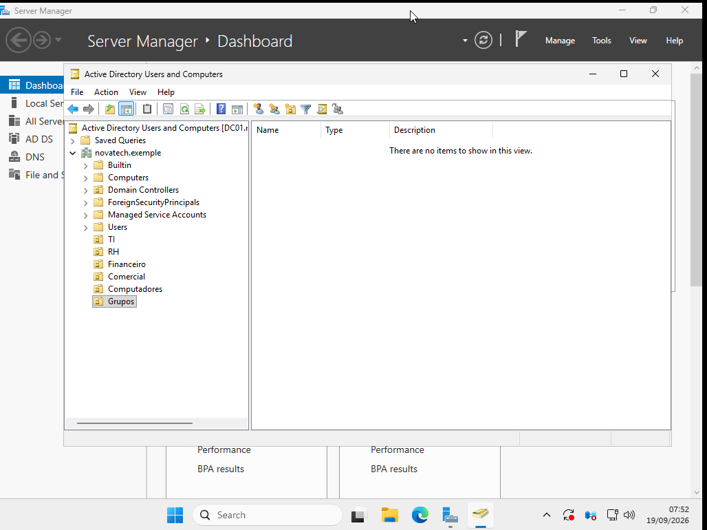
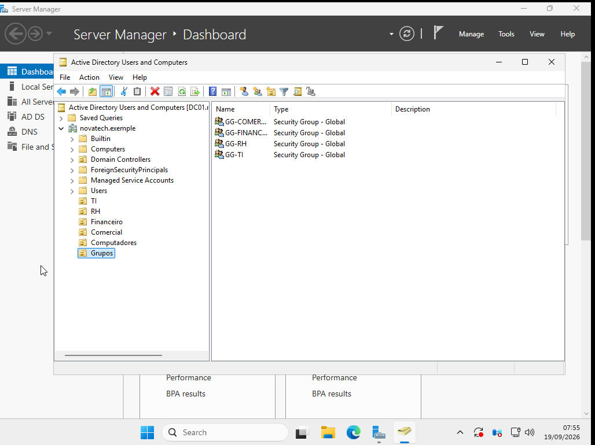
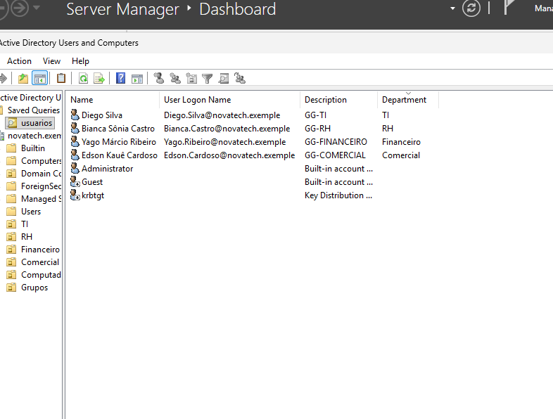

# Estrutura do Active Directory

## Objetivo

Criar uma estrutura organizacional básica no Active Directory para
simular os departamentos de uma pequena empresa.

## Estrutura criada

Domínio:

novatech.exemple

Organizational Units:

- TI
- RH
- Financeiro
- Comercial
- Computadores
- Grupos

## Grupos de segurança

Foram criados os seguintes grupos:

- GG-TI
- GG-RH
- GG-Financeiro
- GG-Comercial

Configuração utilizada:

- Group Scope: Global
- Group Type: Security

## Usuários

Foram criadas contas de usuário fictícias no Active Directory para representar funcionários de diferentes departamentos da empresa e permitir testes de autenticação, permissões e associação a grupos de segurança.

| Usuário | Departamento | Grupo |
|---|---|---|
| Diego.Silva | TI | GG-TI |
| Bianca.Castro | RH | GG-RH |
| Yago.Ribeiro | Financeiro | GG-Financeiro |
| Edson.Cardoso | Comercial | GG-Comercial |

Todos os usuários foram criados com uma senha padrão, tendo que alterar no primeiro acesso.

## Associação de usuários aos grupos de segurança

Após a criação das contas, cada usuário foi associado ao grupo de segurança correspondente ao seu departamento.

Essa organização permite administrar permissões por grupo, evitando a necessidade de conceder acessos individualmente para cada usuário.

A imagem abaixo apresenta os usuários cadastrados no Active Directory, juntamente com seus respectivos departamentos e grupos de segurança.

## O que foi praticado

- Criação de Organizational Units;
- Criação de usuários;
- Criação de grupos de segurança;
- Associação de usuários a grupos;
- Organização lógica do Active Directory;
- Princípio de gerenciamento baseado em grupos.
