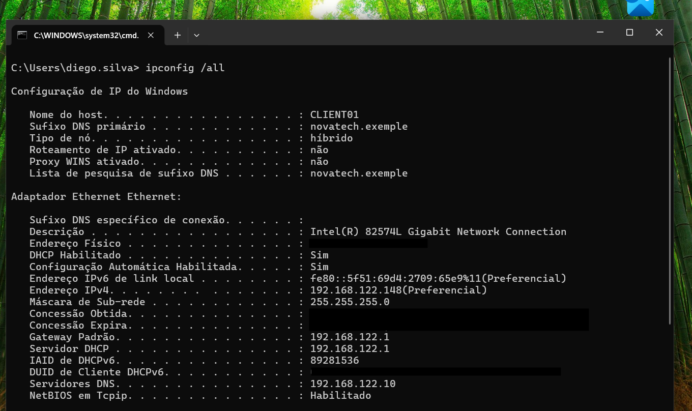
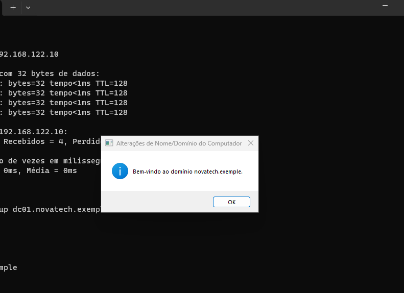
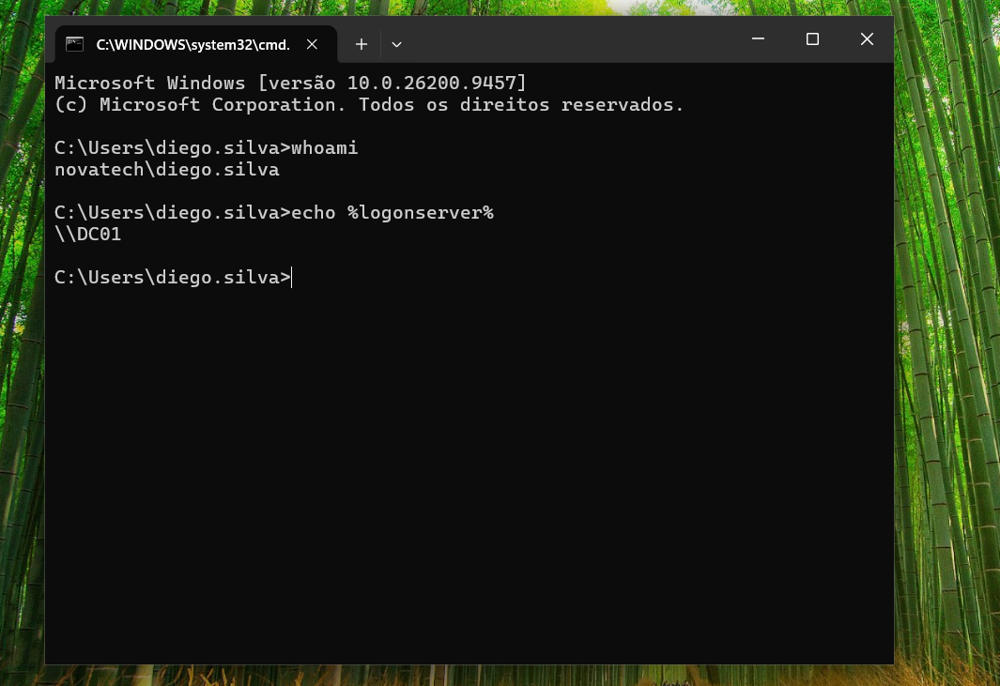

# CLIENT01 - Windows 10 Pro

## Objetivo

Criar uma estação de trabalho cliente para simular o computador de um funcionário da empresa e integrá-la ao domínio Active Directory.

## Configuração da VM

- Sistema: Windows 10 Pro
- Nome do computador: CLIENT01
- RAM: 4 GB
- vCPUs: 2
- Rede: mesma rede virtual do DC01
- DNS: 192.168.122.10

## Configuração de rede

O cliente foi configurado para utilizar o servidor DC01 como DNS principal, permitindo a resolução do domínio interno.



## Ingresso no domínio

O `CLIENT01` foi adicionado ao domínio utilizando uma conta com privilégios administrativos. Após a validação das credenciais, o Windows confirmou que o computador havia sido integrado com sucesso ao domínio.



## Validação

Após o ingresso no domínio, o `CLIENT01` foi reiniciado para aplicar as alterações.

Na tela de login, foi utilizada a conta de domínio:

```text
NOVATECH\Diego.Silva 
```

Depois do login, foram executados os seguintes comandos para validar a autenticação:

```
whoami
echo %logonserver%
```

O comando whoami confirmou que a sessão estava utilizando uma conta pertencente ao domínio:
novatech\diego.silva

O comando echo %logonserver% confirmou que o controlador de domínio responsável pelo processo de autenticação foi o DC01:
\\DC01

