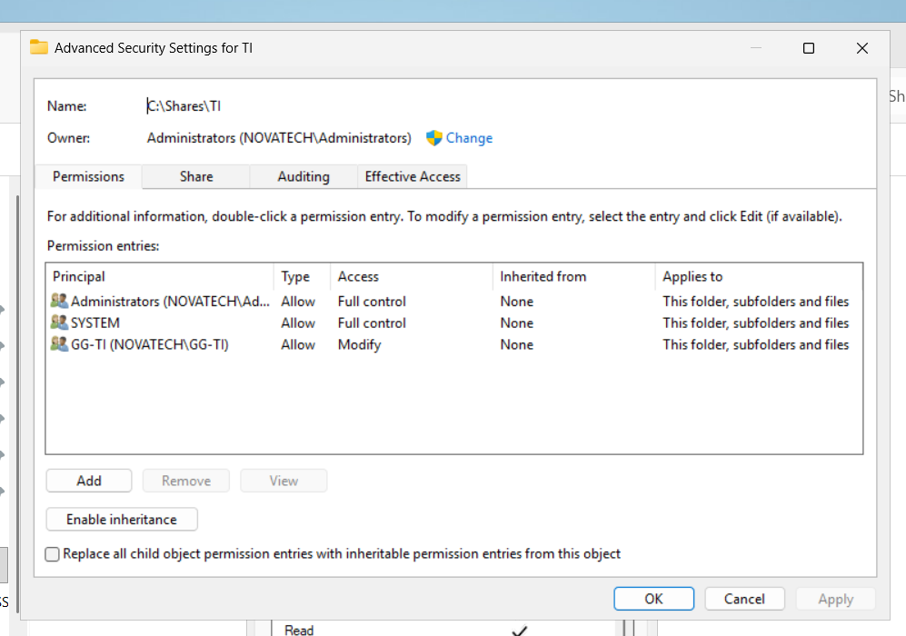
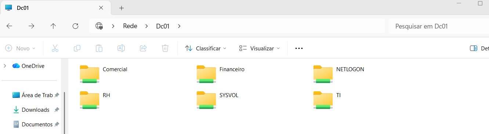
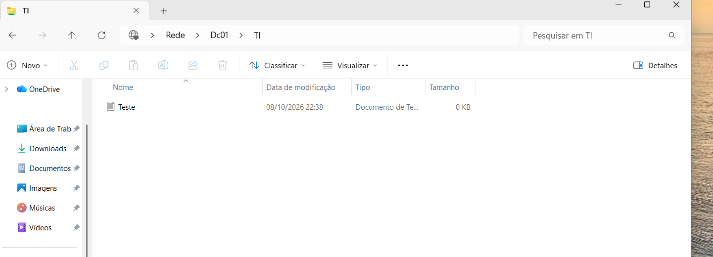
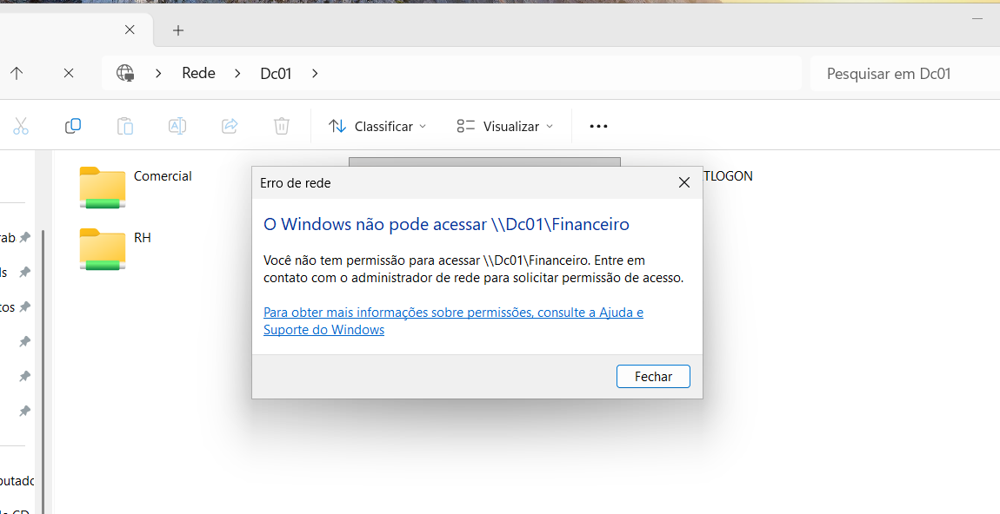

# Compartilhamentos de rede e permissões

## Objetivo

Criar compartilhamentos de rede no servidor `DC01` e controlar o acesso utilizando grupos de segurança do Active Directory.

A ideia é simular um ambiente corporativo onde cada departamento possui acesso apenas aos seus próprios recursos.

## Estrutura dos compartilhamentos

Foram criadas as seguintes pastas no servidor:

- `C:\Compartilhamentos\TI`
- `C:\Compartilhamentos\RH`
- `C:\Compartilhamentos\Financeiro`
- `C:\Compartilhamentos\Comercial`


Os compartilhamentos ficaram disponíveis na rede através dos caminhos:

- `\\DC01\TI`
- `\\DC01\RH`
- `\\DC01\Financeiro`
- `\\DC01\Comercial`

## Permissões NTFS

Na pasta `C:\Shares\TI`, foram configuradas permissões NTFS específicas para controlar o acesso aos arquivos e subpastas.

Foram definidas as seguintes permissões:

| Principal | Permissão |
|---|---|
| Administrators | Full Control |
| SYSTEM | Full Control |
| GG-TI | Modify |

As permissões foram aplicadas à pasta, subpastas e arquivos. O mesmo foi aplicado para as demais pastas com seus respectivos grupos



## Testando as permissões

Para validar o controle de acesso aos compartilhamentos, foram realizados testes a partir do `CLIENT01` utilizando a conta de domínio `NOVATECH\Diego.Silva`, pertencente ao grupo `GG-TI`.

Ao acessar o servidor através do caminho `\\DC01\` obtemos as seguintes pastas:



> **Observação:** `NETLOGON` e `SYSVOL` são compartilhamentos padrão do Active Directory, utilizados para scripts de logon, políticas de grupo e outros arquivos do domínio.

### Acesso permitido à pasta TI

Como o usuário `Diego.Silva` pertence ao grupo `GG-TI`, o acesso ao compartilhamento abaixo foi permitido:

```text
\\DC01\TI
```

Também foi realizado um teste de escrita, criando um arquivo .txt dentro da pasta.



### Acesso negado à pasta Financeiro

Em seguida, foi realizado um teste de acesso ao compartilhamento:
```text
\\DC01\Financeiro
```

Como o usuário `Diego.Silva` não pertence ao grupo `GG-Financeiro`, o Windows negou o acesso à pasta.



Com esses testes, foi possível validar que o controle de acesso aos compartilhamentos está funcionando corretamente com base nos grupos de segurança do Active Directory.