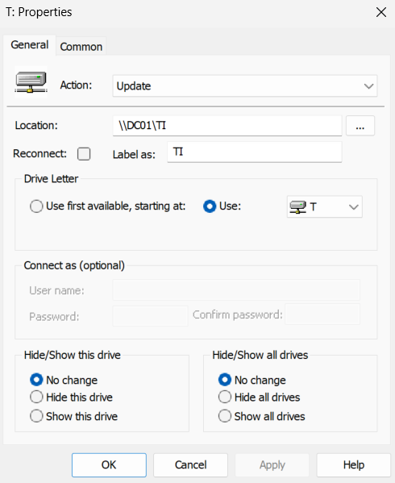
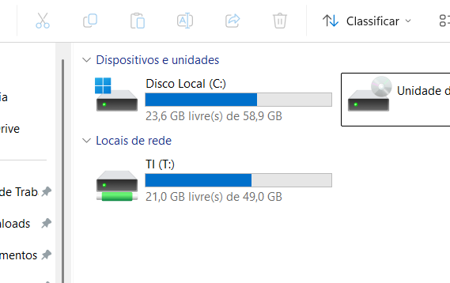
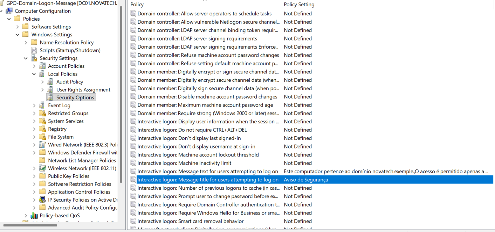
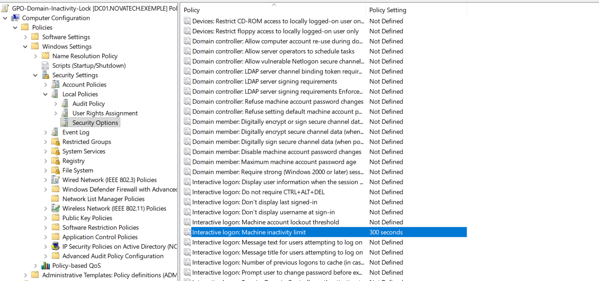

# Gerenciamento de Políticas de Grupo (GPO)

## Objetivo

Configurar e testar Políticas de Grupo (GPOs) no domínio `novatech.exemple`, utilizando o `DC01` como controlador de domínio e o `CLIENT01` como estação de teste.

As GPOs permitem aplicar configurações de forma centralizada aos usuários e computadores do domínio.

## Mapeamento de unidade de rede

Foi criada uma GPO para mapear automaticamente o compartilhamento de rede do departamento de TI para os usuários da OU `TI`.

A política foi vinculada à OU `TI`

Foi criada a GPO `GPO-TI-Map-Network-Drive`

### A configuração foi realizada em:

User Configuration
→ Preferences
→ Windows Settings
→ Drive Maps

### Foram utilizadas as seguintes configurações:

| Configuração | Valor |
|---|---|
| Action | Update |
| Location | \\DC01\TI |
| Drive Letter | T: |
| Label | TI |

 
## Validação no CLIENT01
Para validar a aplicação da política, foi realizado login no CLIENT01 utilizando o usuário de domínio:

```text
NOVATECH\Diego.Silva
```

Em seguida, foi executado:

```text
gpupdate /force
```

Após a atualização das políticas, a unidade de rede foi mapeada automaticamente no Explorador de Arquivos.

A unidade T: passou a apontar para `\\DC01\TI`



O teste confirmou que a GPO foi aplicada corretamente e que o usuário do departamento de TI recebeu automaticamente acesso ao compartilhamento correspondente.

## Mapeamento por departamento

Todos os departamentos foram configurados com suas respectivas unidades de rede, conforme a tabela abaixo:

| Departamento | Unidade | Caminho |
|---|---|---|
| TI | T: | `\\DC01\TI` |
| RH | R: | `\\DC01\RH` |
| Financeiro | F: | `\\DC01\Financeiro` |
| Comercial | M: | `\\DC01\Comercial` |

Cada GPO foi vinculada à OU correspondente, permitindo que os usuários de cada departamento recebam automaticamente o mapeamento da unidade de rede ao realizar login no domínio.


## Mensagem de logon

Foi criada uma GPO para exibir uma mensagem de aviso antes do login nos computadores do domínio. O nome que foi colocado na GPO: `GPO-Domain-Logon-Message`


### A política foi configurada em:

Computer Configuration
→ Policies
→ Windows Settings
→ Security Settings
→ Local Policies
→ Security Options

## Foram configuradas as seguintes opções:

Interactive logon: Message title for users attempting to log on
Interactive logon: Message text for users attempting to log on

O aviso configurado informa que o computador pertence ao domínio novatech.exemple e que o acesso é permitido apenas a usuários autorizados.



Após a aplicação da política no CLIENT01, a mensagem passou a ser exibida antes da tela de login.


## Bloqueio por inatividade

Também foi criada uma GPO para bloquear automaticamente os computadores do domínio após um período de inatividade. O nome que foi colocado na GPO: `GPO-Domain-Inactivity-Lock`

## A configuração foi realizada em:

Computer Configuration
→ Policies
→ Windows Settings
→ Security Settings
→ Local Policies
→ Security Options

## Foram configuradas a seguinte opção:

Interactive logon: Machine inactivity limit



Para fins de teste, o tempo de inatividade foi configurado inicialmente para `300 segundos` equivalente `5 minutos`

Após a aplicação da política no `CLIENT01`, o sistema passou a bloquear automaticamente a sessão após o período configurado de inatividade.