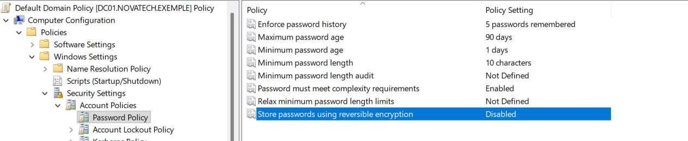
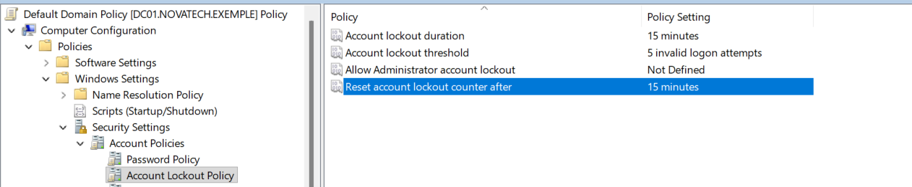
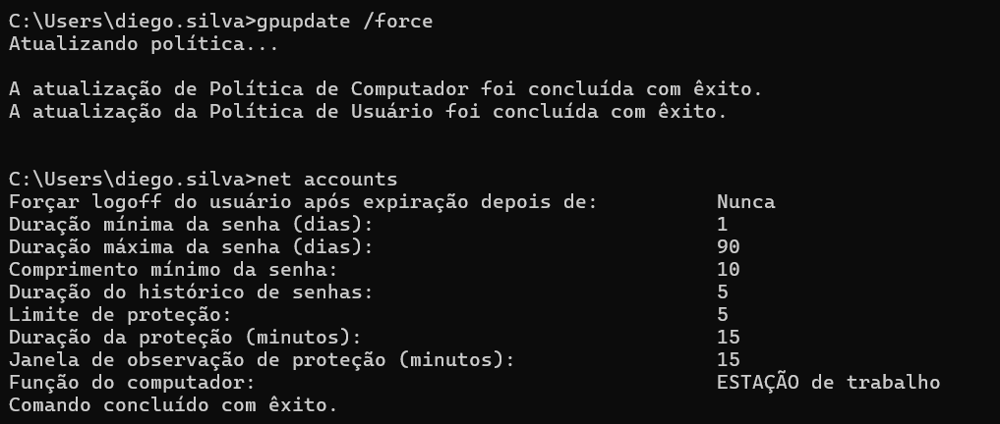
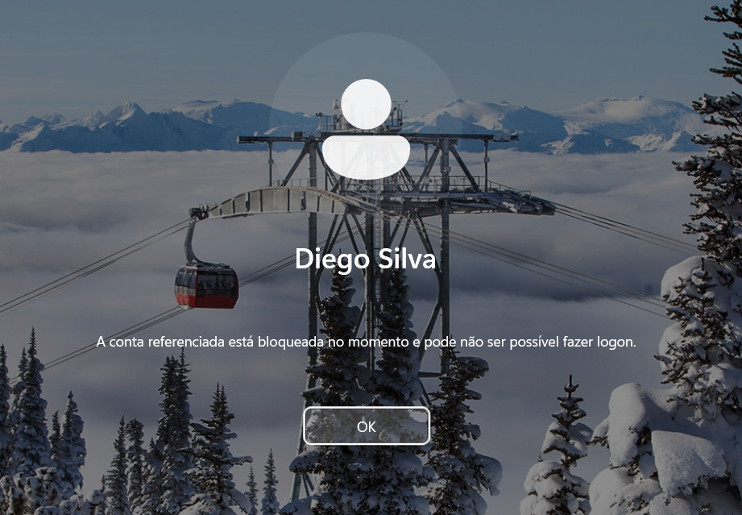

# Políticas de senha e bloqueio de conta

## Objetivo

Configurar e validar políticas de senha e bloqueio de conta no domínio `novatech.exemple`, utilizando a `Default Domain Policy`.

Essas políticas ajudam a aumentar a segurança das contas do domínio, definindo requisitos mínimos para senhas e limitando tentativas incorretas de autenticação.

## Política de senha

A política de senha foi configurada em:

```text
Computer Configuration
→ Policies
→ Windows Settings
→ Security Settings
→ Account Policies
→ Password Policy
```

## Foram utilizadas as seguintes configurações:

| Configuração | Valor |
|---|---|
| Enforce password history | 5 passwords remembered |
| Maximum password age | 90 days |
| Minimum password age | 1 day |
| Minimum password length | 10 characters |
| Password must meet complexity requirements | Enabled |
| Store passwords using reversible encryption | Disabled |



Essas configurações definem requisitos mínimos para as senhas utilizadas pelos usuários do domínio.

## Política de bloqueio de conta

A política de bloqueio foi configurada em:

```text
Computer Configuration
→ Policies
→ Windows Settings
→ Security Settings
→ Account Policies
→ Account Lockout Policy
```

## Foram utilizadas as seguintes configurações:


| Configuração | Valor |
|---|---|
| Account lockout threshold | 5 invalid logon attempts |
| Account lockout duration | 15 minutes |
| Reset account lockout counter after | 15 minutes |



Com essa configuração, uma conta é bloqueada após cinco tentativas inválidas de login e permanece bloqueada pelo período definido.

## Validação das políticas

Para validar as configurações aplicadas ao `CLIENT01`, foi executado o comando:
```text
net accounts
```

O resultado confirmou os principais valores configurados no domínio:



## Teste de tentativas inválidas

Para testar a política de bloqueio, foram realizadas tentativas consecutivas de login utilizando uma senha incorreta para o usuário `Diego.Silva`.

Durante as tentativas, o Windows passou a informar que as credenciais estavam incorretas e aplicou um atraso antes de permitir uma nova tentativa.


## Validação do bloqueio de conta

Após atingir o limite configurado de cinco tentativas inválidas, a conta foi bloqueada automaticamente pelo domínio.

O `CLIENT01` passou a exibir uma mensagem informando que a conta estava bloqueada e que o logon não poderia ser realizado naquele momento.



O teste confirmou que a política de bloqueio de conta foi aplicada corretamente e está funcionando conforme configurado.

## Resultado

Com as políticas configuradas, o domínio passou a aplicar requisitos mínimos de senha e proteção contra tentativas repetidas de autenticação.

As configurações foram validadas tanto pelo comando `net accounts` quanto por um teste prático de bloqueio de conta no `CLIENT01`.