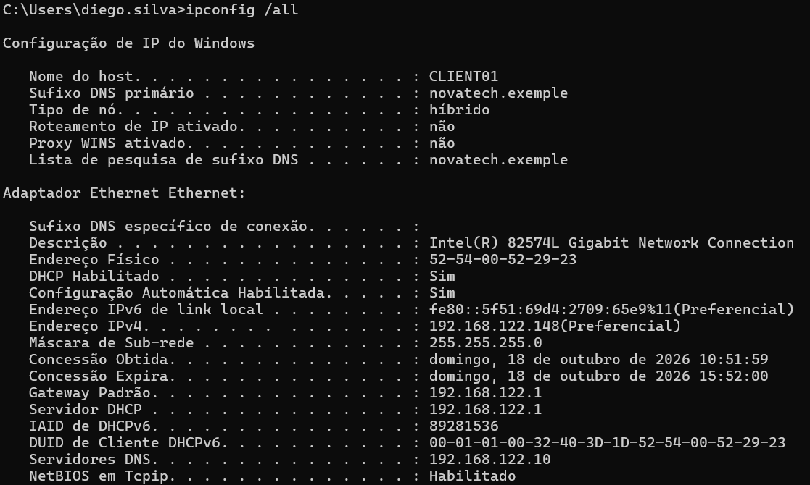
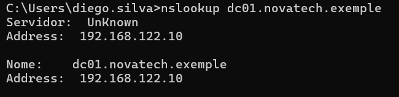
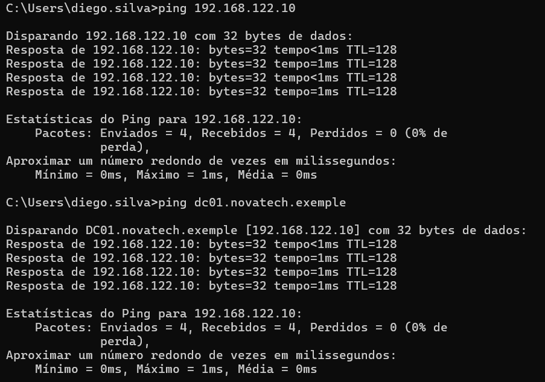
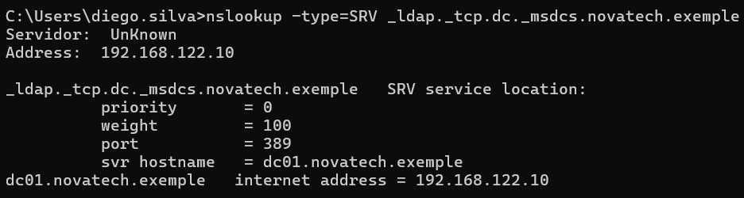

# Configuração de rede e DNS

## Objetivo

Documentar e validar a configuração de rede do laboratório, garantindo a comunicação entre o `CLIENT01` e o `DC01`, além do funcionamento correto da resolução DNS utilizada pelo Active Directory.

A resolução DNS é essencial em ambientes de domínio, pois os computadores clientes utilizam o DNS para localizar controladores de domínio e serviços do Active Directory.

## Configuração de rede do DC01

O controlador de domínio `DC01` utiliza uma configuração IPv4 estática:

| Configuração | Valor |
|---|---|
| IPv4 | `192.168.122.10` |
| Máscara de sub-rede | `255.255.255.0` |
| Gateway | `192.168.122.1` |
| DNS | `192.168.122.10` |

O próprio `DC01` é utilizado como servidor DNS do domínio `novatech.exemple`.

## Configuração de rede do CLIENT01

O `CLIENT01` recebe seu endereço IPv4 através de DHCP e utiliza o `DC01` como servidor DNS.

Foi utilizado o comando:

```cmd
ipconfig /all
```

Para validar a configuração de rede da estação.

Entre as informações verificadas estão:

| Configuração | Valor |
|---|---|
| Hostname | CLIENT01 |
| Sufixo DNS | novatech.exemple |
| IPv4 | 192.168.122.148 |
| Máscara | 255.255.255.0 |
| Gateway | 192.168.122.1 |
| Servidor DNS | 192.168.122.10 |



## Validação da resolução DNS

Para verificar se o `CLIENT01` conseguia resolver corretamente o nome do controlador de domínio, foi executado:
```text
nslookup dc01.novatech.exemple
```



A consulta retornou o endereço `192.168.122.10`

confirmando que o nome `dc01.novatech.exemple` está sendo resolvido corretamente pelo servidor DNS.

## Teste de conectividade

A comunicação entre o CLIENT01 e o DC01 foi testada utilizando o comando ping.
Primeiro, o teste foi realizado diretamente pelo endereço IPv4:

```text
ping 192.168.122.10
```

Em seguida, o teste foi realizado utilizando o nome DNS do servidor:

```text
ping dc01.novatech.exemple
```



Os dois testes obtiveram resposta do DC01, confirmando tanto a conectividade IP quanto a resolução de nomes.

## Validação do registro SRV do Active Directory

O Active Directory utiliza registros DNS do tipo SRV para permitir que clientes localizem serviços importantes do domínio, como LDAP e controladores de domínio.
Para validar esse funcionamento, foi executado:

```text
nslookup -type=SRV _ldap._tcp.dc._msdcs.novatech.exemple
```

A consulta retornou o `DC01` como servidor responsável pelo serviço LDAP:




## Resultado 

Os testes confirmaram que o CLIENT01 está configurado corretamente para utilizar o DC01 como servidor DNS.
Também foi validado que:

- existe conectividade entre o CLIENT01 e o DC01;
- o nome dc01.novatech.exemple é resolvido corretamente;
- o domínio novatech.exemple utiliza o DNS interno do controlador de domínio;
- os registros SRV necessários para localizar os serviços do Active Directory estão funcionando corretamente.

Com isso, a comunicação de rede e a resolução DNS necessárias para o funcionamento do domínio foram validadas com sucesso.