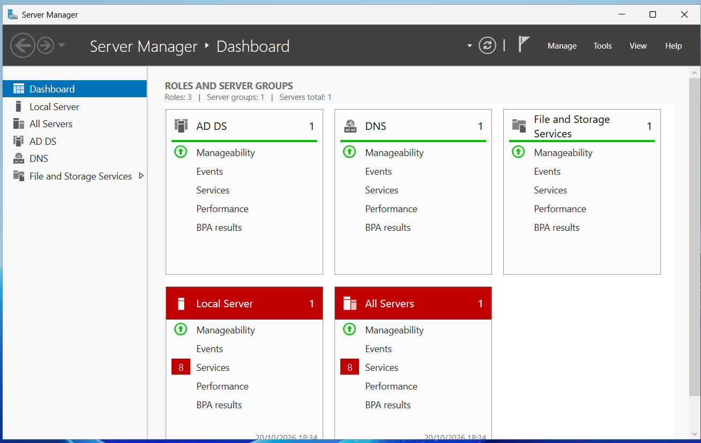
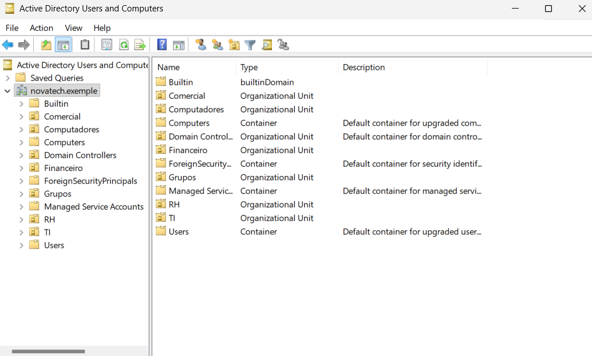
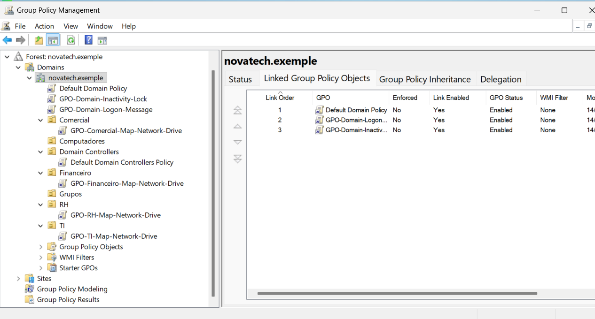
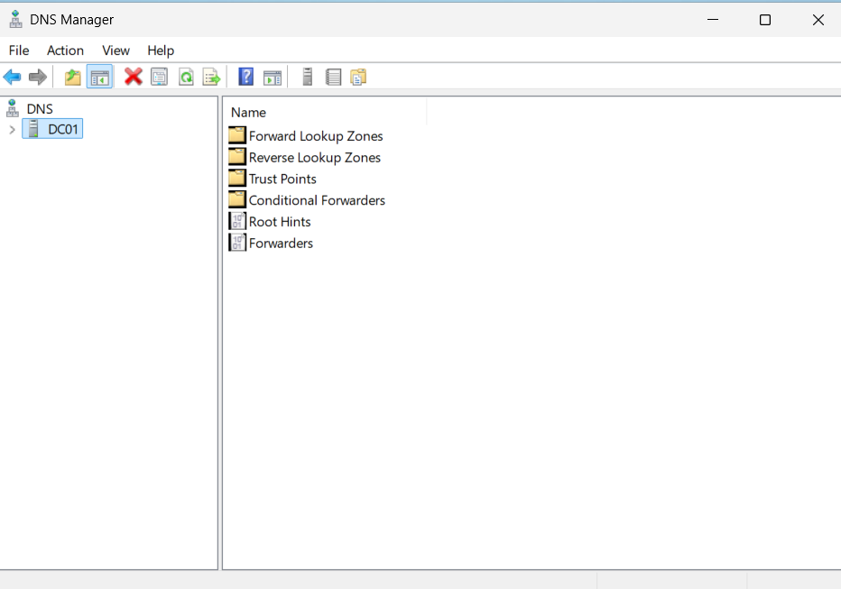
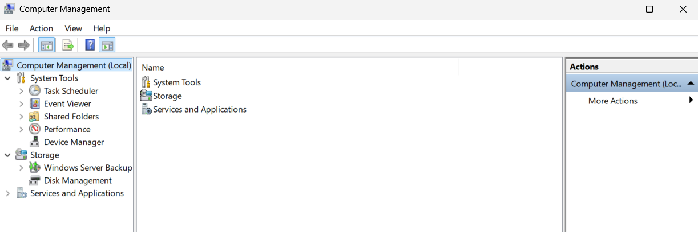
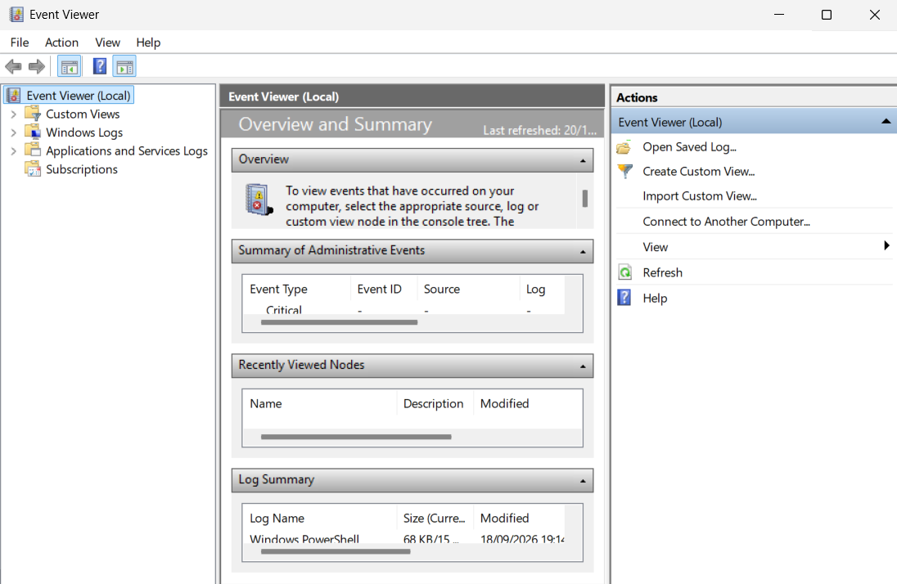
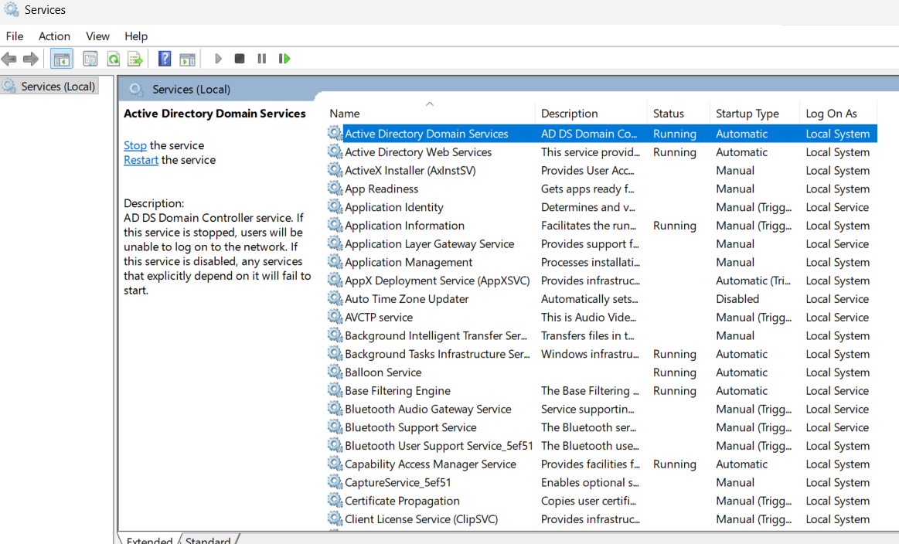
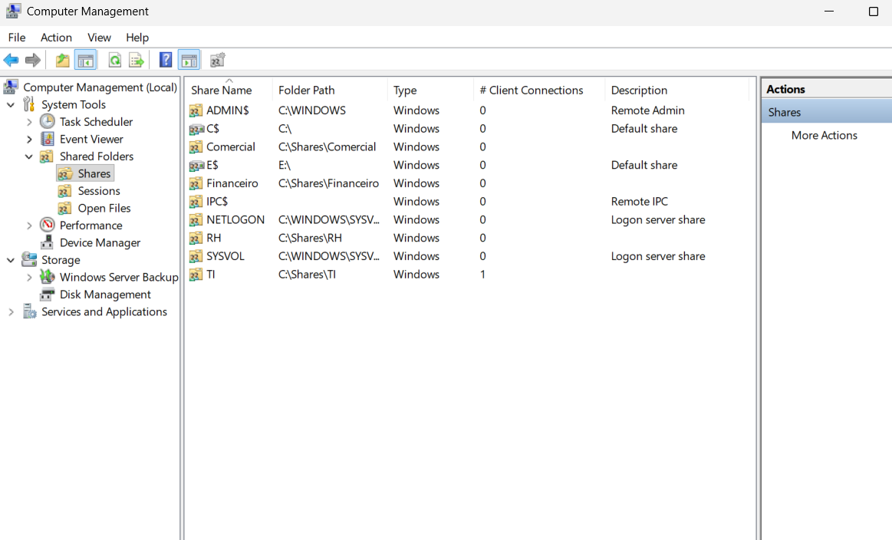

# Ferramentas administrativas do Windows Server

## Objetivo

Conhecer e documentar as principais ferramentas administrativas utilizadas no `DC01` para gerenciamento do domínio, usuários, políticas, DNS, serviços, eventos e compartilhamentos de rede.

Essas ferramentas fazem parte da rotina de administração de ambientes Windows Server e são utilizadas para configurar, monitorar e solucionar problemas em uma infraestrutura baseada em Active Directory.

## Server Manager

O **Server Manager** é o painel central de administração do Windows Server.

Através dele é possível visualizar funções instaladas, acompanhar o estado do servidor e acessar diversas ferramentas administrativas.

No laboratório, ele é utilizado para acompanhar serviços como:

- Active Directory Domain Services (AD DS)
- DNS
- File and Storage Services

### Exemplo de uso

O Server Manager pode ser utilizado para verificar se as funções instaladas no servidor estão funcionando corretamente e acessar rapidamente outras ferramentas administrativas.



## Active Directory Users and Computers

O **Active Directory Users and Computers (ADUC)** é a principal ferramenta gráfica para gerenciamento de objetos do Active Directory.

Através dela é possível administrar:

- usuários;
- grupos;
- computadores;
- unidades organizacionais (OUs).

### Exemplo de uso

No laboratório, essa ferramenta foi utilizada para organizar os usuários nas OUs `TI`, `RH`, `Financeiro` e `Comercial`, além de criar e administrar grupos de segurança.



## Group Policy Management

O **Group Policy Management** é utilizado para criar, editar e vincular Políticas de Grupo (GPOs).

As GPOs permitem aplicar configurações de forma centralizada aos usuários e computadores do domínio.

### Exemplo de uso

No laboratório, essa ferramenta foi utilizada para configurar políticas como:

- mapeamento automático de unidades de rede;
- mensagem de logon;
- bloqueio automático por inatividade.



## DNS Manager

O **DNS Manager** permite administrar o serviço DNS do Windows Server.

Em um ambiente Active Directory, o DNS é essencial para que computadores e usuários consigam localizar o controlador de domínio e outros serviços da rede.

### Exemplo de uso

No laboratório, o DNS Manager pode ser utilizado para visualizar os registros da zona:

```text
novatech.exemple
```

incluindo registros associados ao `DC01` e aos serviços do **Active Directory**.



## Computer Management

O **Computer Management** reúne diversas ferramentas administrativas em um único console. Entre as opções disponíveis estão:

- Event Viewer;
- Shared Folders;
- Device Manager;
- Disk Management;
- Services.

### Exemplo de uso

Um administrador pode utilizar o **Computer Management** para verificar compartilhamentos ativos, analisar eventos do sistema ou consultar serviços em execução.



## Event Viewer

O **Event Viewer** registra eventos gerados pelo Windows, aplicações e serviços.

Ele é uma das principais ferramentas utilizadas para diagnóstico e troubleshooting em sistemas Windows.

Os principais logs incluem:

- Application
- Security
- Setup
- System

### Exemplo de uso

Caso um usuário não consiga realizar login no domínio, o administrador pode consultar o log Security para procurar eventos relacionados a tentativas de autenticação.



## Services

A ferramenta Services permite visualizar e administrar os serviços executados no Windows.

É possível verificar o estado de um serviço, iniciá-lo, interrompê-lo ou reiniciá-lo quando necessário.

### Exemplo de uso

No controlador de domínio, alguns serviços importantes incluem:

- Active Directory Domain Services
- DNS Server
- Kerberos Key Distribution Center
- Netlogon

Se algum desses serviços apresentar problema, funcionalidades do domínio podem ser afetadas.



## Shared Folders

A seção Shared Folders, disponível no Computer Management, permite visualizar os compartilhamentos de rede existentes no servidor.

Também é possível consultar sessões de usuários e arquivos abertos através da rede.

### Exemplo de uso

No laboratório, essa ferramenta permite visualizar os compartilhamentos departamentais:

- TI
- RH
- Financeiro
- Comercial

além dos compartilhamentos padrão do Active Directory:

- NETLOGON
- SYSVOL



## Resultado

As principais ferramentas administrativas disponíveis no Windows Server foram identificadas e documentadas.

Cada ferramenta possui uma função específica na administração do ambiente, permitindo gerenciar usuários, políticas, DNS, eventos, serviços e compartilhamentos de forma centralizada.

Essas ferramentas serão utilizadas novamente nas próximas etapas do laboratório, principalmente em tarefas de administração, segurança e troubleshooting.