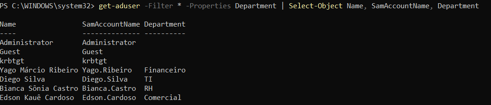
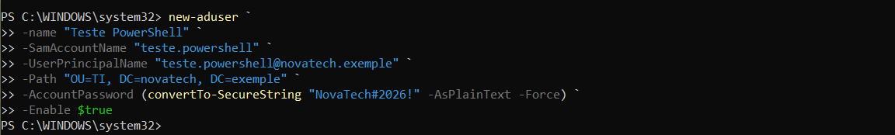
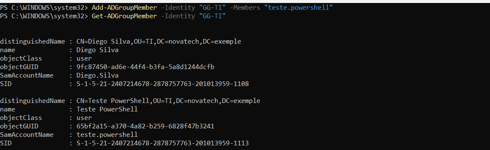
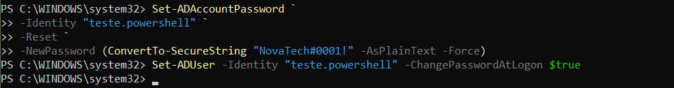
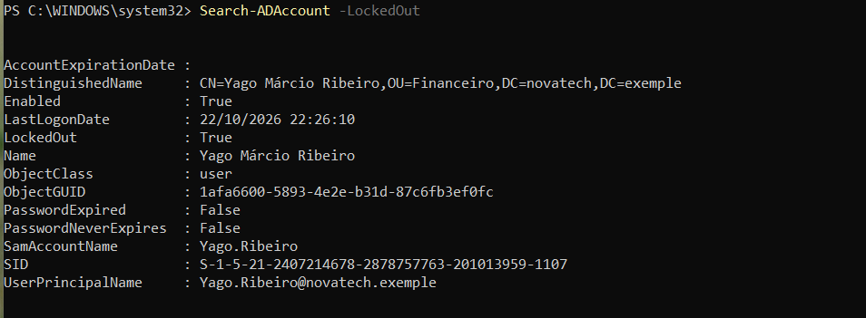
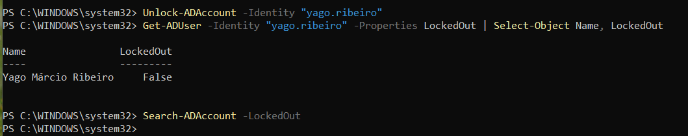

# Administração do Active Directory com PowerShell

## Objetivo

Utilizar o PowerShell para consultar e administrar objetos do Active Directory a partir do `CLIENT01`, utilizando as ferramentas RSAT.

O uso do PowerShell permite automatizar tarefas administrativas e realizar operações no Active Directory de forma mais rápida e escalável.

## Preparação do ambiente

Inicialmente, os cmdlets do Active Directory, como:

```powershell
Get-ADUser
Import-Module ActiveDirectory
```

não estavam disponíveis no `CLIENT01`.

Ao tentar carregar o módulo, o PowerShell retornava um erro informando que o módulo `ActiveDirectory` não havia sido encontrado.

Foi verificado o status das ferramentas RSAT utilizando:

```powershell
Get-WindowsCapability -Name RSAT.ActiveDirectory.DS-LDS.Tools* -Online
```

Em seguida, as ferramentas do Active Directory foram instaladas com:

```powershell
Add-WindowsCapability -Online -Name "Rsat.ActiveDirectory.DS-LDS.Tools~~~~0.0.1.0"
```

Após a instalação, o módulo foi carregado:

```powershell
Import-Module ActiveDirectory
```

Com isso, os cmdlets de administração do Active Directory passaram a funcionar normalmente no `CLIENT01`.

## Consulta de usuários

Para consultar os usuários do domínio e algumas de suas propriedades, foi utilizado:

```powershell
Get-ADUser -Filter * -Properties Department |
Select-Object Name, SamAccountName, Department
```

O comando permite visualizar informações como nome, nome de logon e departamento dos usuários cadastrados no Active Directory.



## Criação de usuário

Foi criado um usuário de teste diretamente pelo PowerShell utilizando o cmdlet `New-ADUser`.

```powershell
New-ADUser `
  -Name "Teste PowerShell" `
  -SamAccountName "teste.powershell" `
  -UserPrincipalName "teste.powershell@novatech.exemple" `
  -Path "OU=TI,DC=novatech,DC=exemple" `
  -AccountPassword (ConvertTo-SecureString "NovaTech#2026!" -AsPlainText -Force) `
  -Enabled $true
```

Após a criação, o usuário foi validado com:

```powershell
Get-ADUser -Identity "teste.powershell"
```



## Associação a grupo

O usuário criado foi adicionado ao grupo de segurança `GG-TI` utilizando:

```powershell
Add-ADGroupMember -Identity "GG-TI" -Members "teste.powershell"
```

Para validar a associação:

```powershell
Get-ADGroupMember -Identity "GG-TI"
```



## Gerenciamento de senha

Também foi realizado o reset de senha do usuário através do PowerShell:

```powershell
Set-ADAccountPassword `
  -Identity "teste.powershell" `
  -Reset `
  -NewPassword (ConvertTo-SecureString "NovaTech#0001!" -AsPlainText -Force)
```

Em seguida, foi configurado que o usuário deveria alterar a senha no próximo logon:

```powershell
Set-ADUser -Identity "teste.powershell" -ChangePasswordAtLogon $true
```



## Consulta de contas bloqueadas

Para localizar contas bloqueadas no domínio, foi utilizado:

```powershell
Search-ADAccount -LockedOut
```

Esse comando permite identificar rapidamente usuários que atingiram o limite de tentativas inválidas configurado na política de bloqueio de conta.



## Desbloqueio de conta

Uma conta bloqueada pode ser desbloqueada através do cmdlet:

```powershell
Unlock-ADAccount -Identity "teste.powershell"
```

Para validar o estado da conta:

```powershell
Get-ADUser -Identity "teste.powershell" -Properties LockedOut |
Select-Object Name, LockedOut
```



## Outros comandos utilizados

Outros comandos úteis durante a administração do domínio incluem:

### Consultar grupos

```powershell
Get-ADGroup -Filter *
```

### Consultar membros de um grupo

```powershell
Get-ADGroupMember -Identity "GG-TI"
```

### Consultar computadores do domínio

```powershell
Get-ADComputer -Filter *
```

### Remover um usuário

```powershell
Remove-ADUser -Identity "teste.powershell"
```

Antes de excluir um usuário, é possível confirmar suas informações com:

```powershell
Get-ADUser -Identity "teste.powershell"
```


## Resultado

Foi possível administrar diferentes objetos do Active Directory diretamente pelo PowerShell a partir do `CLIENT01`.

As atividades realizadas incluíram:

- consulta de usuários;
- criação de usuário;
- associação a grupo;
- gerenciamento de senha;
- consulta de contas bloqueadas;
- desbloqueio de conta;
- consulta de grupos e computadores.

Com isso, foi validado o uso do PowerShell como ferramenta de administração remota do Active Directory utilizando RSAT.