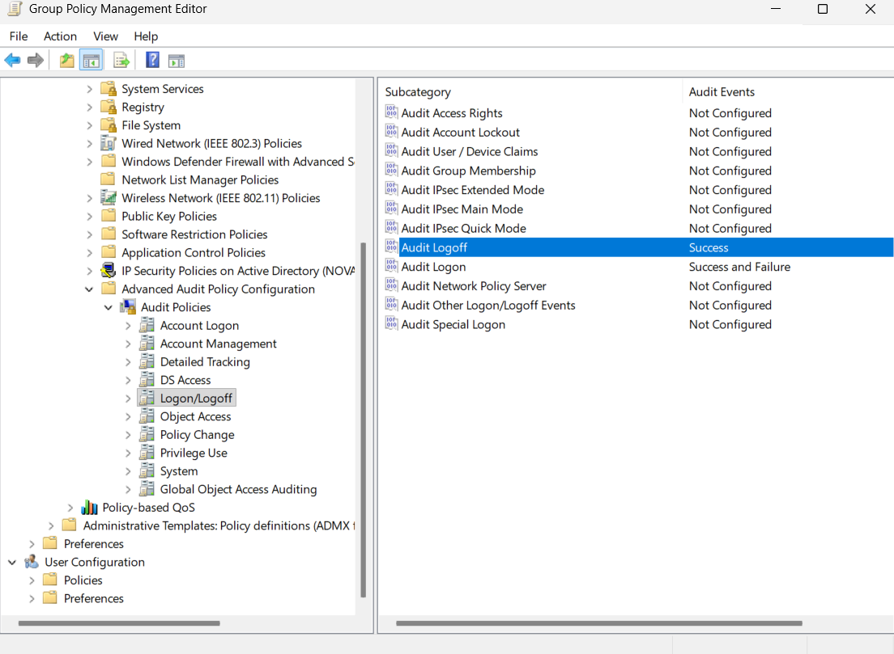
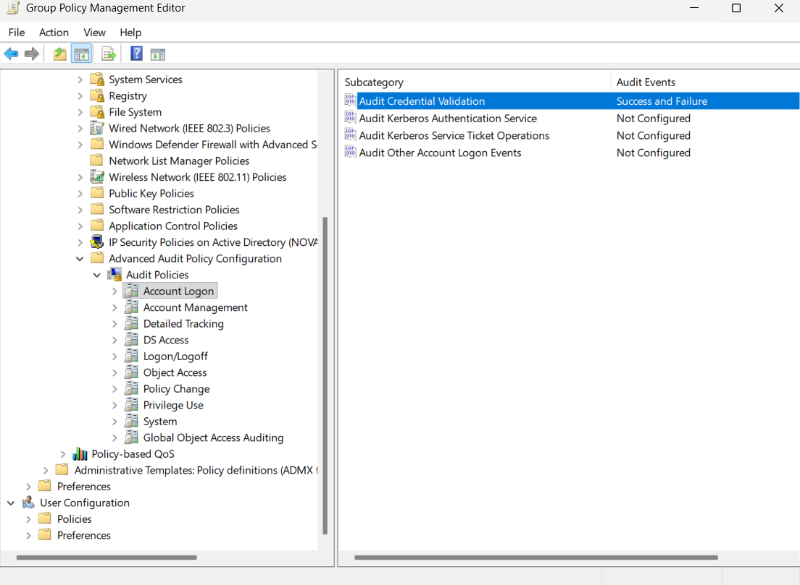
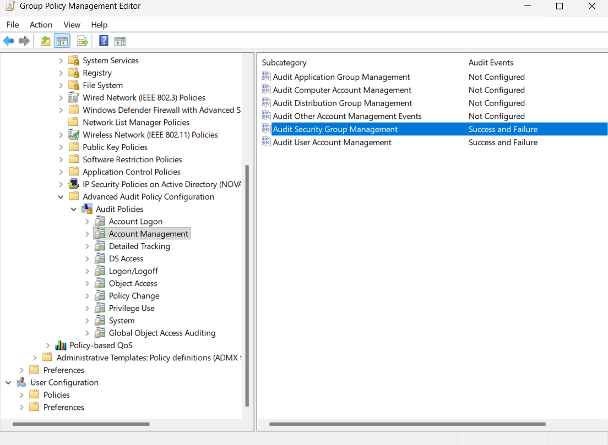
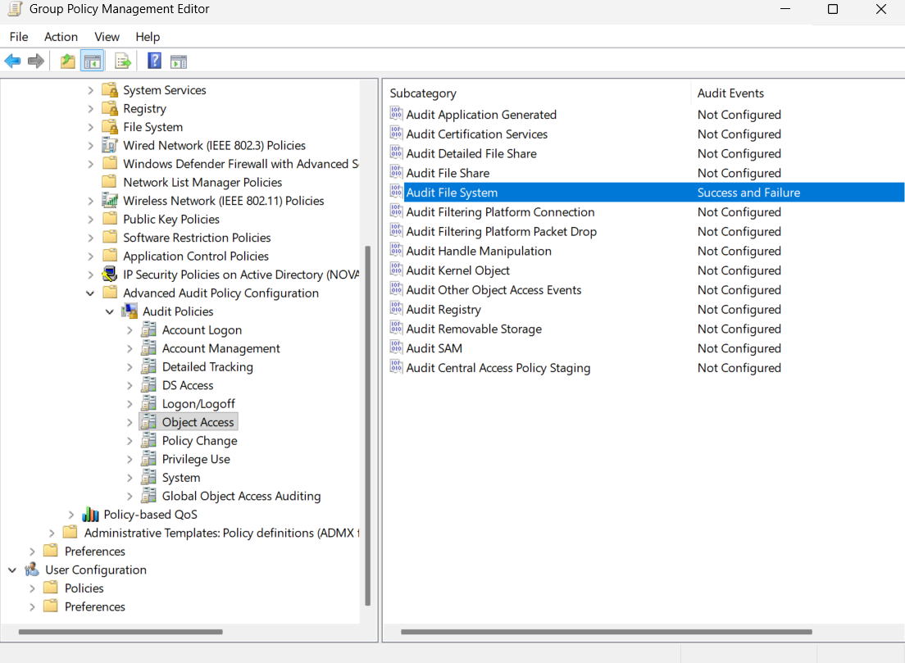
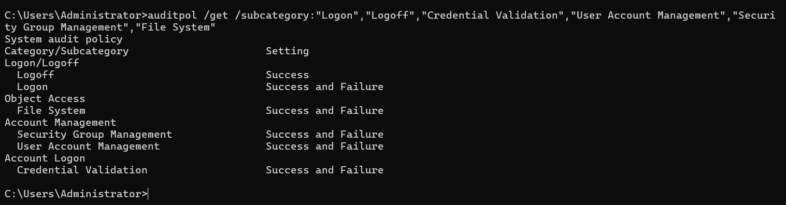
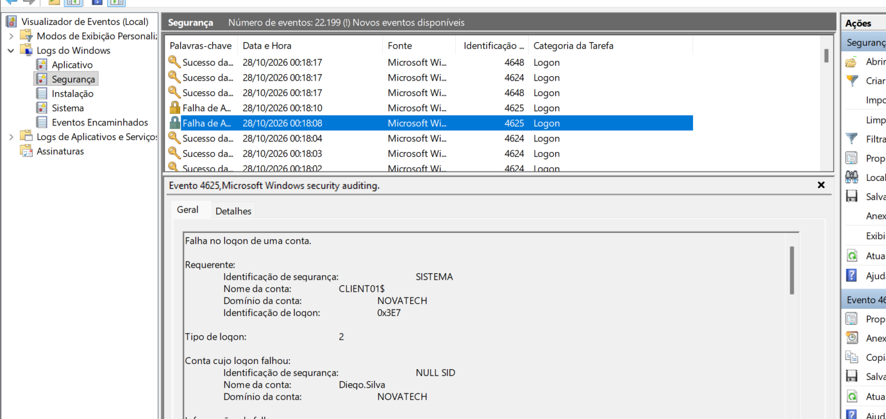
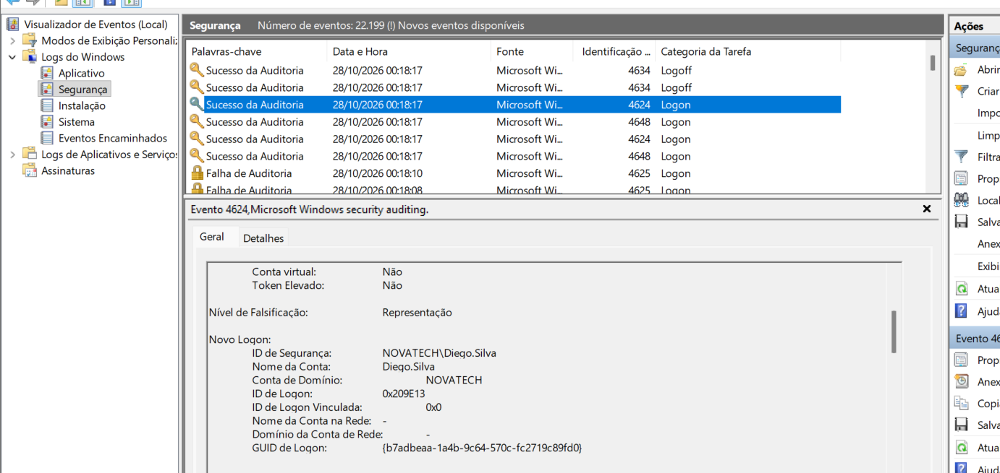
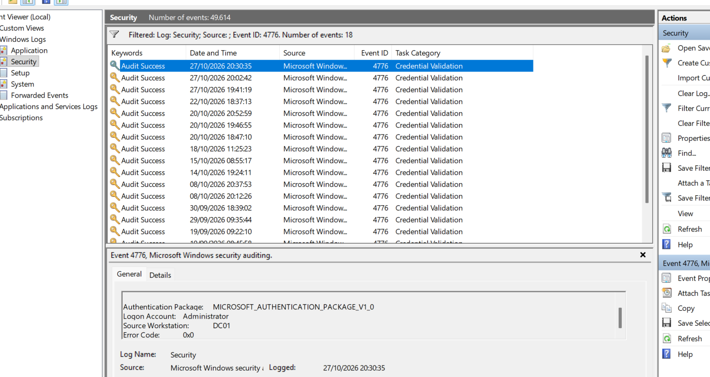

# Auditoria de segurança

## Objetivo

Configurar e validar políticas de auditoria de segurança no domínio `novatech.exemple`, permitindo registrar eventos importantes relacionados a autenticação, gerenciamento de contas, grupos de segurança e acesso ao sistema de arquivos.

A auditoria permite acompanhar atividades realizadas nos computadores e no Active Directory, auxiliando em tarefas de monitoramento, troubleshooting e investigação de segurança.

## GPO de auditoria

Foi criada uma GPO específica para as configurações de auditoria:

```text
GPO-Domain-Security-Auditing
```

A política foi vinculada à OU `Domain Controllers` e também à OU `Computadores`.

As configurações foram realizadas em:

```text
Computer Configuration
→ Policies
→ Windows Settings
→ Security Settings
→ Advanced Audit Policy Configuration
→ Audit Policies
```

## Auditoria de logon e logoff

Foram configuradas as seguintes subcategorias:

```text
Audit Logon
→ Success
→ Failure

Audit Logoff
→ Success
```

Essas configurações permitem registrar tentativas de logon bem-sucedidas e malsucedidas, além do encerramento de sessões.



## Auditoria de validação de credenciais

Na categoria `Account Logon`, foi configurada:

```text
Audit Credential Validation
→ Success
→ Failure
```

Essa auditoria permite registrar tentativas de validação de credenciais realizadas pelo controlador de domínio.



## Auditoria de gerenciamento de contas e grupos

Na categoria `Account Management`, foram configuradas:

```text
Audit User Account Management
→ Success
→ Failure

Audit Security Group Management
→ Success
→ Failure
```

Essas políticas permitem registrar ações relacionadas a usuários e grupos de segurança do Active Directory.



## Auditoria de acesso ao sistema de arquivos

Na categoria `Object Access`, foi configurada:

```text
Audit File System
→ Success
→ Failure
```

Essa política permite registrar eventos relacionados ao acesso a arquivos e pastas quando a auditoria também é configurada diretamente no objeto.



## Validação das políticas

Após a aplicação da GPO, as subcategorias configuradas foram validadas utilizando o comando:

```cmd
auditpol /get /subcategory:"Logon","Logoff","Credential Validation","User Account Management","Security Group Management","File System"
```

O resultado confirmou que as políticas estavam ativas conforme configurado.



## Eventos locais no CLIENT01

Os eventos relacionados diretamente à sessão do usuário foram analisados no Event Viewer do próprio `CLIENT01`.

Por padrão, cada computador Windows mantém seus próprios logs locais.

### Falha de logon

Foi realizada uma tentativa de autenticação utilizando credenciais inválidas.

O evento correspondente foi:

```text
Event ID: 4625
Descrição: An account failed to log on
```



### Logon bem-sucedido

Também foi realizado um login utilizando credenciais válidas.

O evento correspondente foi:

```text
Event ID: 4624
Descrição: An account was successfully logged on
```



## Validação de credenciais no DC01

Eventos relacionados à autenticação do domínio também foram analisados no `DC01`.

Durante uma autenticação, o controlador de domínio registrou:

```text
Event ID: 4776
Descrição: The computer attempted to validate the credentials for an account
```

Esse evento mostra a participação do controlador de domínio no processo de validação das credenciais utilizadas pelos usuários do domínio.



## Onde os eventos são registrados

Durante os testes foi possível observar que os eventos não são automaticamente centralizados no `DC01`.

Por padrão:

```text
CLIENT01
→ eventos locais da estação

DC01
→ eventos locais do servidor e eventos relacionados ao Active Directory
```

Por esse motivo, os eventos `4624` e `4625` foram analisados diretamente no `CLIENT01`, enquanto o evento `4776` foi analisado no `DC01`.

Em ambientes que necessitam centralizar logs de diversas máquinas, podem ser utilizadas tecnologias como Windows Event Forwarding (WEF) ou plataformas SIEM.

## Eventos analisados

| Event ID | Função |
|---|---|
| `4624` | Logon bem-sucedido |
| `4625` | Falha de logon |
| `4776` | Validação de credenciais pelo controlador de domínio |

## Resultado

As políticas avançadas de auditoria foram configuradas e validadas com sucesso.

Foi possível registrar e analisar eventos relacionados a:

- logons bem-sucedidos;
- falhas de autenticação;
- validação de credenciais pelo controlador de domínio;
- gerenciamento de contas e grupos;
- acesso ao sistema de arquivos.

Com isso, o ambiente passou a possuir uma base de auditoria que poderá ser utilizada posteriormente em atividades de troubleshooting, monitoramento e investigação de segurança.