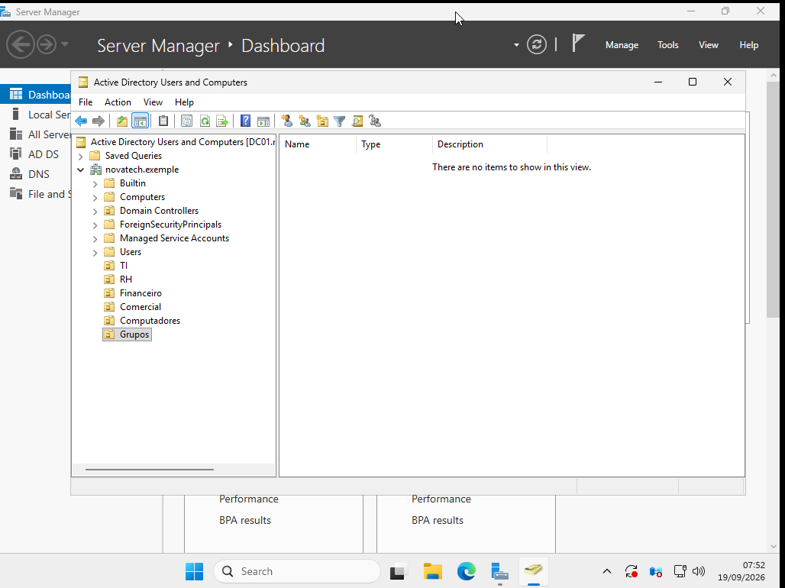
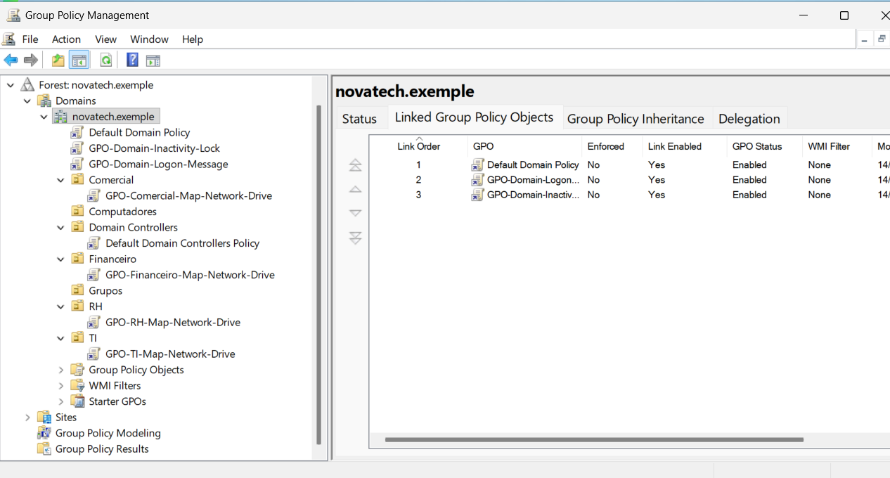
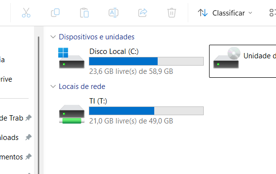
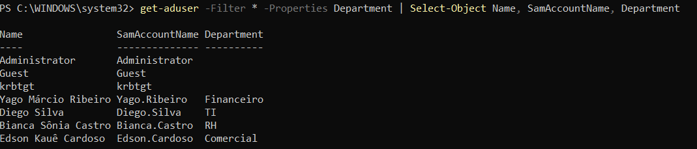
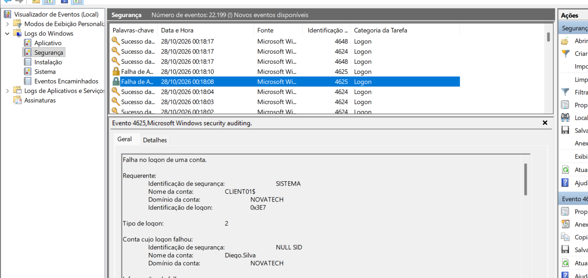

# IT Support & Windows Infrastructure Home Lab

Laboratório prático de IT Support e infraestrutura Windows que simula um ambiente corporativo com Active Directory, DNS, políticas de grupo, administração remota, compartilhamentos e auditoria de segurança.

## Projeto em evolução contínua

Este laboratório está em desenvolvimento contínuo. O repositório registra minha evolução em suporte, infraestrutura, administração Windows e segurança, com configurações, testes e evidências adicionados conforme avanço nos estudos.

A base implementada está descrita abaixo. Novos cenários de suporte, automações e atividades de troubleshooting continuarão sendo incorporados à documentação.

## Objetivo

Praticar a administração de um domínio Windows, desde a configuração dos serviços até a validação de autenticação, permissões e políticas. O ambiente permite exercitar tarefas de suporte e investigar o comportamento dos sistemas com comandos, consoles administrativos e logs.

## Arquitetura do ambiente

```text
Ubuntu Host
└── KVM / QEMU + libvirt
    └── Rede virtual default — NAT — 192.168.122.0/24
        ├── DC01
        │   ├── Windows Server 2025 Evaluation
        │   ├── IPv4 estático: 192.168.122.10
        │   ├── Active Directory Domain Services
        │   └── DNS: 192.168.122.10
        │
        └── CLIENT01
            ├── Windows 11 Pro
            ├── IPv4 via DHCP
            ├── DNS: 192.168.122.10
            └── Membro do domínio novatech.exemple
```

### Máquinas do laboratório

| Máquina | Sistema operacional | Função | Configuração de rede |
|---|---|---|---|
| **DC01** | Windows Server 2025 Evaluation | Controlador de domínio, DNS e compartilhamentos departamentais | IPv4 estático `192.168.122.10/24`; gateway `192.168.122.1`; DNS `192.168.122.10` |
| **CLIENT01** | Windows 11 Pro | Estação de teste e administração remota com RSAT | IPv4 via DHCP na rede `192.168.122.0/24`; gateway `192.168.122.1`; DNS `192.168.122.10` |

> A visão geral utiliza Windows 11 Pro conforme o contexto atual do laboratório. O documento de ingresso do CLIENT01 no domínio ainda menciona Windows 10 Pro.

## Tecnologias utilizadas

| Área | Tecnologias |
|---|---|
| Virtualização | Ubuntu, KVM/QEMU, libvirt e virt-manager |
| Sistemas operacionais | Windows Server 2025 e Windows 11 Pro |
| Identidade e rede | Active Directory Domain Services (AD DS) e DNS |
| Administração | Group Policy (GPO), PowerShell e RSAT |
| Arquivos e permissões | SMB, NTFS e grupos de segurança do Active Directory |
| Auditoria | Event Viewer e Advanced Audit Policy |

## O que foi implementado

- [x] Configuração do DC01 com endereço IP estático.
- [x] Instalação do AD DS, criação do domínio `novatech.exemple` e DNS integrado.
- [x] Organização de OUs, usuários fictícios e grupos de segurança por departamento.
- [x] Ingresso do CLIENT01 no domínio e validação de autenticação.
- [x] Compartilhamentos departamentais com permissões NTFS por grupo.
- [x] Testes de acesso permitido e negado aos compartilhamentos.
- [x] Mapeamento de unidades por GPO, mensagem de logon e bloqueio por inatividade.
- [x] Políticas de senha e teste de bloqueio por tentativas inválidas.
- [x] Validação de conectividade, resolução DNS e registros SRV do Active Directory.
- [x] Administração do AD via PowerShell e RSAT no CLIENT01.
- [x] Configuração de auditoria avançada e análise de eventos de autenticação.

## Estrutura do Active Directory

O domínio `novatech.exemple` possui OUs para os departamentos e para a organização de computadores e grupos:

```text
novatech.exemple
├── TI
├── RH
├── Financeiro
├── Comercial
├── Computadores
└── Grupos
```

Os grupos `GG-TI`, `GG-RH`, `GG-Financeiro` e `GG-Comercial` foram criados com escopo **Global** e tipo **Security**. As contas de teste são associadas aos grupos de seus departamentos para administrar o acesso aos recursos por grupo.

## Compartilhamentos e unidades de rede

Os compartilhamentos SMB ficam no DC01. As permissões NTFS utilizam os grupos departamentais, e as GPOs vinculadas às OUs correspondentes fazem o mapeamento das unidades.

| Departamento | Grupo de segurança | Compartilhamento | Unidade |
|---|---|---|---|
| TI | `GG-TI` | `\\DC01\TI` | `T:` |
| RH | `GG-RH` | `\\DC01\RH` | `R:` |
| Financeiro | `GG-Financeiro` | `\\DC01\Financeiro` | `F:` |
| Comercial | `GG-Comercial` | `\\DC01\Comercial` | `M:` |

Os testes documentados com um usuário de TI confirmaram acesso e escrita na pasta TI e acesso negado à pasta Financeiro. O mapeamento da unidade `T:` também foi validado no CLIENT01.

## Group Policy

As políticas centralizam configurações de usuários e computadores do domínio. Entre as GPOs documentadas estão:

| Política | Aplicação no laboratório |
|---|---|
| `GPO-TI-Map-Network-Drive` | Mapeamento de `\\DC01\TI` como unidade `T:` para a OU TI; os demais departamentos também possuem seus mapeamentos |
| `GPO-Domain-Logon-Message` | Aviso de acesso autorizado antes do login |
| `GPO-Domain-Inactivity-Lock` | Bloqueio da sessão após 300 segundos de inatividade nos testes |
| `Default Domain Policy` | Requisitos de senha e bloqueio de conta após tentativas inválidas |
| `GPO-Domain-Security-Auditing` | Auditoria avançada nas OUs Domain Controllers e Computadores |

## PowerShell e RSAT

O CLIENT01 também foi utilizado como estação administrativa remota. A instalação das ferramentas RSAT e o carregamento do módulo `ActiveDirectory` permitiram administrar objetos do domínio pelo PowerShell.

As práticas documentadas incluem consulta e criação de usuários, associação a grupos, redefinição de senha, exigência de troca no próximo logon, consulta de contas bloqueadas e desbloqueio. Essas atividades formam a base para futuras automações.

## Auditoria e Event Viewer

A Advanced Audit Policy foi configurada para logon/logoff, validação de credenciais, gerenciamento de contas e grupos e acesso ao sistema de arquivos. As configurações foram verificadas com `auditpol`; a auditoria de arquivos também depende da configuração no objeto auditado.

No Event Viewer, foram analisados os seguintes eventos:

| Event ID | Evento | Máquina analisada |
|---|---|---|
| `4624` | Logon bem-sucedido | CLIENT01 |
| `4625` | Falha de logon | CLIENT01 |
| `4776` | Validação de credenciais | DC01 |

Os logs são locais a cada máquina. A análise documentada consulta os eventos na estação e no controlador de domínio, sem centralização de logs implementada nesta etapa.

## Documentação

Os procedimentos, comandos, configurações e resultados detalhados estão nos 11 documentos de `Docs/01 - Configuration/`:

| Etapa | Documento |
|---|---|
| 01 | [Configuração do Windows Server — DC01](Docs/01%20-%20Configuration/01-windows-server-setup.md) |
| 02 | [Active Directory Domain Services e DNS](Docs/01%20-%20Configuration/02-active-directory-domain-services.md) |
| 03 | [Estrutura do Active Directory](Docs/01%20-%20Configuration/03-active-directory-structure.md) |
| 04 | [Ingresso do CLIENT01 no domínio](Docs/01%20-%20Configuration/04-client01-domain-join.md) |
| 05 | [Compartilhamentos de rede e permissões](Docs/01%20-%20Configuration/05-file-sharing-and-permissions.md) |
| 06 | [Gerenciamento de Políticas de Grupo](Docs/01%20-%20Configuration/06-group-policy-management.md) |
| 07 | [Políticas de senha e bloqueio de conta](Docs/01%20-%20Configuration/07-password-and-account-policies.md) |
| 08 | [Configuração de rede e DNS](Docs/01%20-%20Configuration/08-network-and-dns-configuration.md) |
| 09 | [Ferramentas administrativas do Windows Server](Docs/01%20-%20Configuration/09-administration-tools.md) |
| 10 | [Administração do Active Directory com PowerShell](Docs/01%20-%20Configuration/10-powershell-administration.md) |
| 11 | [Auditoria de segurança](Docs/01%20-%20Configuration/11-security-auditing.md) |

## Evidências visuais

Uma seleção dos registros disponíveis; as demais evidências acompanham os procedimentos na documentação.

### Active Directory — organização das OUs



### Group Policy — políticas e vínculos



### Unidade de rede — TI no CLIENT01



### PowerShell — consulta de usuários do domínio



### Auditoria — falha de logon



## Estrutura do repositório

```text
it-support-cybersecurity-homelab/
├── README.md
├── Docs/
│   ├── 01 - Configuration/       # 11 documentos da base do ambiente
│   ├── 02 - Support-Scenarios/
│   ├── 03 - Security-Labs/
│   └── 04 - Automation/
└── ScreenShots/
    ├── 01-Configuration/        # Evidências das configurações e testes
    ├── 02-Support-Scenarios/
    ├── 03-Security-Labs/
    └── 04-Automation/
```

As pastas das fases 02 a 04 já existem e ainda não contêm documentação ou screenshots. Elas estão disponíveis para os próximos cenários do laboratório.

## Próximos passos

As próximas fases podem incluir, conforme a evolução dos estudos:

- Cenários reais de suporte com registro do sintoma, diagnóstico, solução e validação.
- Troubleshooting de contas bloqueadas, ampliando os testes de bloqueio e desbloqueio já documentados.
- Investigação de problemas de DNS e localização do controlador de domínio.
- Diagnóstico de falhas de aplicação de GPO e de mapeamento de unidades.
- Resolução de problemas de acesso a recursos e permissões.
- Automações em PowerShell para tarefas recorrentes de administração.
- Ampliação das práticas de monitoramento e segurança.

Este repositório permanece como um registro prático e em atualização contínua: cada novo cenário amplia a experiência com suporte e administração de infraestrutura Windows.
